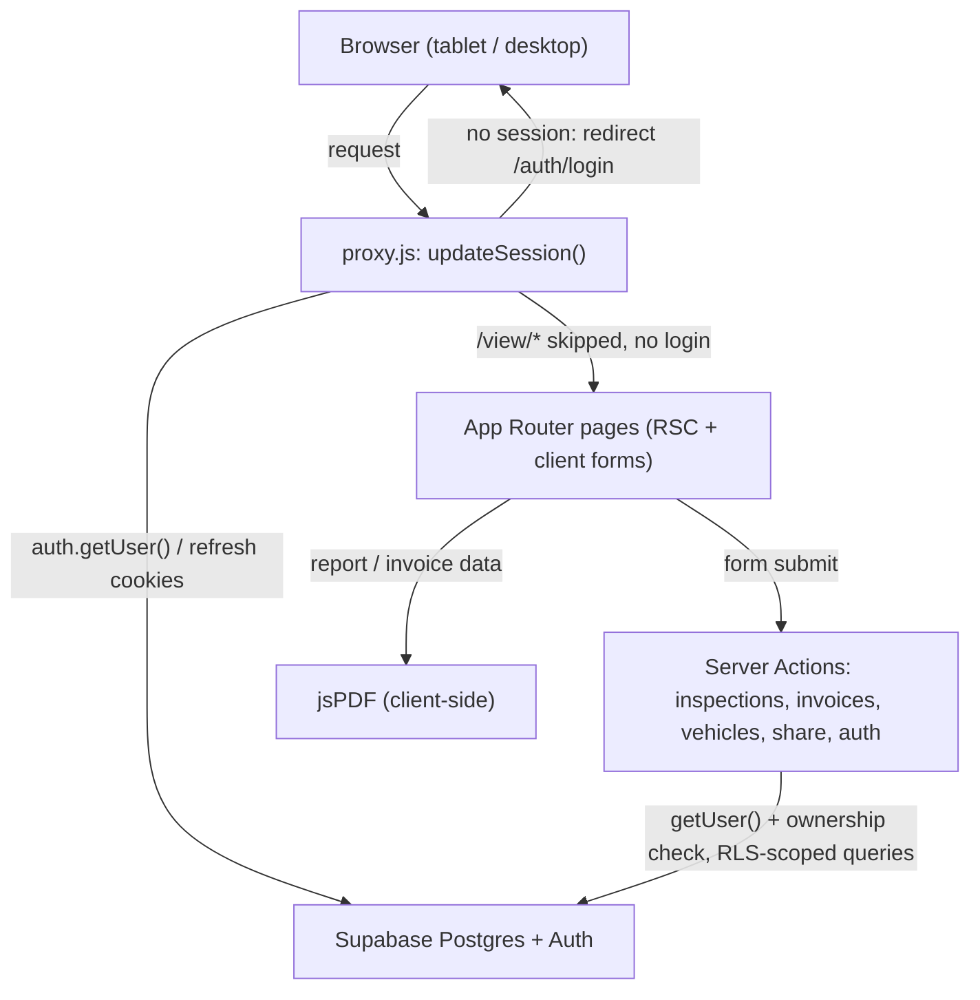
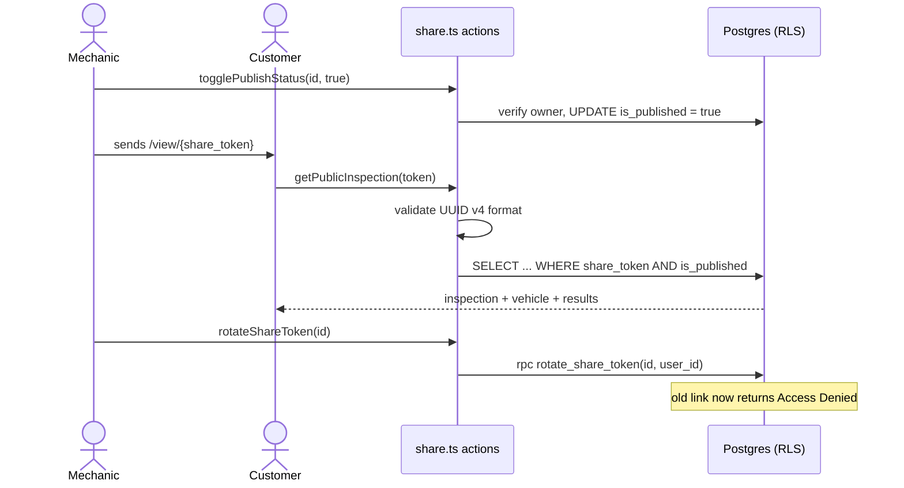
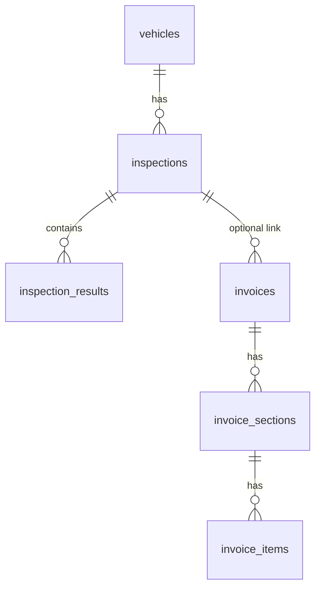

# Mechanic Pro Inspection App

(repo: vehicle-inspection-app)

*Multi-point vehicle inspection and invoicing app for an auto repair shop. Freelance project built for **Prince Auto Works**.*

A multi-point vehicle inspection and invoicing app for an auto repair shop. A mechanic records a green/yellow/red inspection on a tablet, publishes it as a revocable public link for the customer, and bills the work from the same data.


[Live app](https://vehicle-inspection-app.vercel.app/)

## Pitch

Paper multi-point inspection forms get lost, are hard to read, and cannot be sent to the customer. Prince Auto Works needed the same checklist on a screen, plus a way to show the customer what was found and invoice the repair afterwards.

The app replaces the paper form with a four-category checklist plus a four-corner tire tread grid. Each item carries a traffic-light status, an optional measurement, and notes. A finished report is shared through a UUID token in the URL. The owner can switch the link off or rotate the token, which kills the old URL immediately. The same data feeds an invoice builder with free-form sections (labor, parts, diagnostics) and a tax rate.

There is no separate API layer. Mutations are Next.js Server Actions, and authorization is split between the action (ownership check) and Postgres Row Level Security. Row ownership is enforced in the database, not only in application code.

The brand shown to users in the UI and PDFs is "Mechanic Pro". "Prince Auto Works" is the client, not a string in the code.

## Features

**Inspections**
- **Checklist form** — 31 items in four categories (Under Car, Under Hood, Exterior, Road Test), each with green/yellow/red/N/A status, a measurement field and notes.
- **Tire tread grid** — LF/RF/LR/RR inputs in 32nds of an inch; the grid colors each tire green at 6 or above, yellow at 3 to 5, red below 3.
- **Draft and complete workflow** — save as draft, edit later, mark completed (sets `completed_at`), or delete.
- **Report view** — summary counts of critical, caution and passed items, results grouped by category, print stylesheet for A4 output.

**Sharing**
- **Public report links** — `/view/[token]` renders a published report with no login; unpublished or unknown tokens return an "Access Denied" page.
- **Revocation** — toggle `is_published` off, or rotate the token through a Postgres function that checks the caller owns the inspection.

**Clients, vehicles, billing**
- **Clients and vehicles** — a vehicle row holds the customer name and email; the clients page groups vehicles by customer. Vehicle input is validated with Zod.
- **Invoices** — dynamic sections with line items, tax rate, subtotal/tax/total computed on the server, `draft`/`sent`/`paid` status, auto-numbered `INV-0001` style per user by a database trigger. Client and vehicle dropdowns prefill the form.
- **PDF export** — compact A4 PDFs for inspections and invoices generated in the browser with jsPDF and jspdf-autotable.

**Access**
- **Auth** — email/password sign-up and login, and magic link login, through Supabase Auth. All routes except the auth pages and `/view/*` redirect to login.

## How It Works

### Request flow



### Public sharing



### Data model

Tables are created by the SQL files in `scripts/`: `profiles`, `vehicles`, `inspections`, `inspection_results`, `invoices`, `invoice_sections`, `invoice_items`. Every table has RLS enabled. There is no separate `clients` table.



### Key decisions

- **Server Actions over a REST API**: mutations live in `app/actions/*.ts` and return `{ success, error }` objects instead of an API route per operation, because the only client is this Next.js app and it removes a layer to maintain.
- **One row per checklist item**: `inspection_results` stores category, item name, status and measurement as rows with a `CHECK` on status, rather than one JSONB blob per inspection, so the database rejects invalid statuses and results can be queried and counted. The early planning doc described a JSONB column; the shipped schema does not use one.
- **Ownership checked twice**: each action verifies `user_id` against `auth.getUser()`, and RLS policies repeat the check in Postgres, so a missed check in application code does not expose another shop user's rows.
- **Hardened `SECURITY DEFINER` function**: `rotate_share_token` takes the requesting user id and raises if it does not own the inspection. The first version had no check, and `CODE_REVIEW.md` records that it was fixed in `003_rotate_token_function.sql`.
- **Client-side PDFs**: jsPDF draws the report and invoice in the browser instead of rendering HTML on a server, so there is no headless browser to host. The cost is that layout is hand-coded in `lib/pdf.ts`.

## Tech Stack

| Technology | Role | Why |
| ---------- | ---- | --- |
| Next.js 16 (App Router), React 19 | Pages, Server Actions, routing proxy | — |
| TypeScript | Language | — |
| Supabase (`@supabase/ssr`) | Auth, Postgres, RLS | Auth, database and row-level authorization in one hosted service for a small shop |
| Tailwind CSS 4, shadcn/ui (Radix) | UI | — |
| Zod, react-hook-form | Input validation | — |
| jsPDF + jspdf-autotable | PDF export | Runs in the browser, no server rendering |
| sonner | Toasts | — |
| Vercel Analytics | Page analytics | — |

## Getting Started

### Prerequisites

- Node.js 20 or newer
- A Supabase project

### Install

```bash
git clone https://github.com/yassine-krichen/vehicle-inspection-app.git
cd vehicle-inspection-app
npm install
```

The repo holds both `package-lock.json` and `pnpm-lock.yaml`; either package manager works.

### Configure

Create `.env.local` with the variables in the Configuration table. There is no `.env.example` yet.

### Database

Run the SQL files in `scripts/` in order in the Supabase SQL editor:

1. `001_initial_schema.sql`
2. `002_add_share_token.sql`
3. `003_rotate_token_function.sql`
4. `004_invoices_schema.sql`

### Run

```bash
npm run dev      # http://localhost:3000
npm run build && npm start
npm run lint
```

There are no automated tests in the repo.

## Configuration

| Variable | Required | Default | Description |
| -------- | -------- | ------- | ----------- |
| `NEXT_PUBLIC_SUPABASE_URL` | Yes | — | Supabase project URL, used by the server client and the proxy |
| `NEXT_PUBLIC_SUPABASE_ANON_KEY` | Yes | — | Supabase anon key; access is limited by RLS |
| `NEXT_PUBLIC_APP_URL` | No | `http://localhost:3000` on the server, `window.location.origin` in the browser | Base URL used to build public share links |

## Key Server Actions

| Action | File | Purpose |
| ------ | ---- | ------- |
| `createInspection`, `updateInspection`, `completeInspection`, `deleteInspection` | `app/actions/inspections.ts` | Inspection lifecycle with per-item results |
| `togglePublishStatus`, `rotateShareToken`, `getPublicInspection` | `app/actions/share.ts` | Publish, revoke and read shared reports |
| `createInvoice`, `updateInvoiceStatus`, `deleteInvoice` | `app/actions/invoices.ts` | Invoices with sections and server-side totals |
| `createVehicle`, `getVehicles` | `app/actions/vehicles.ts` | Zod-validated vehicle and customer records |
| `loginWithPassword`, `signupWithPassword`, `loginWithMagicLink`, `logout` | `app/actions/auth.ts` | Supabase Auth flows |

## Project Notes

- Built between 2025-12-26 and 2026-02-28 (8 commits).
- Known gaps, from the code: `next.config.mjs` sets `typescript.ignoreBuildErrors: true`; `createInvoice` inserts the invoice, sections and items in separate calls without a transaction; the signup and magic-link `emailRedirectTo` is built from `NEXT_PUBLIC_SUPABASE_URL` instead of the app URL; `RATE_LIMIT` constants exist but no rate limiting is implemented.
- `DEVELOPMENT_CONTEXT.md`, `CODE_REVIEW.md`, `MIGRATION_GUIDE.md` and `SHARE_FEATURE_README.md` are working notes from development. Parts are out of date (they mention Prisma, Next.js 14 and `middleware.ts`; the code uses Supabase directly, Next.js 16 and `proxy.js`).

## Roadmap

| Status | Item |
| ------ | ---- |
| Done | Inspection checklist, tire grid, draft/complete workflow |
| Done | Public share links with revoke and rotate |
| Done | Invoices with sections, tax and PDF export |
| Planned | Rate limiting on token rotation and inspection creation — constants are defined, enforcement is not |
| Planned | Automated tests for the Server Actions and RLS policies |
| Planned | Transactional invoice creation |

## License

**Source-available, not open source.** Mechanic Pro is published under the
[PolyForm Strict License 1.0.0](LICENSE): you may read, run, and learn from the code
for personal, research, or evaluation use.

You may **not** use it commercially, redistribute it, rebrand it, or publish modified
versions without written permission. Copyright (c) 2026 Yassine Krichen. All rights
not granted by the license are reserved.

For commercial licensing or collaboration: krichenyassine22@gmail.com
